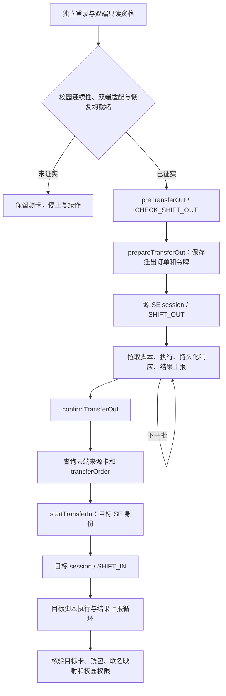

# 路线 A：复旦联名身份与独立迁移状态机

## 本阶段结论与操作边界

2026-11-22，Mac America/Los_Angeles。已完成独立 TSM 登录和双端服务资格，证据沿用 `xiaomi-tsm-eligibility-2026-11-22.json`，没有重复登录/查询。本阶段新增发行方联名网页静态分析、完整客户端主干和恢复分支分析，以及离线协调器测试。

**尚不能确认 K70 → Xiaomi Watch S4 会保留复旦校园身份。** 这不是“不支持”的结论：基础产品的源迁出/目标迁入资格已经成功，发行方另有按卡号识别联名身份的链路。缺口是这条具体手机→手表迁移是否保持原卡号，或在换号/换 SE 时同步维护联名和校园映射。

用户补充“可以尝试真正迁出”，同时要求“无法确定校园身份能否保留，不要擅自迁移”。因此真实写操作仍以校园连续性与恢复能力得到证明为前提，本阶段未执行 `preTransferOut`、prepare、SE session、迁出/迁入、冻结、解绑、退款或开卡。生产 `app/`、版本、APK 和配对不改。新代码只有公共资产检查和明确的离线模拟；不是可用于真实卡的迁移客户端。

新证据：`docs/evidence/xiaomi-campus-migration-2026-11-22.json`。研究模块：`tools/research/xiaomi-transit-migration`。认证模块保持原四条精确只读路径，没有放宽 allowlist。

## 标识分层：哪些相同不等于校园身份相同

| 层次 | 已定位标识/字段 | 已知作用 | 迁移连续性 |
| --- | --- | --- | --- |
| 基础交通产品 | 小米 `cardName=SPTC_MOT` | 上海公共交通卡·交通联合版；已在 S4 产品目录与 ACL 成功 | 目标必须支持同产品，但单凭此项不足 |
| 联名产品 | 上海交通卡 `coBrandCard=SPTC.MOT.SH.FDU`、`partnerNo=06000047`、`campusTag=fudan`、`cardTag=8001` | 公共配置明确对应复旦大学；不是附属复兴中学条目 | 是否被 Xiaomi 云端订单保留/转交尚未证实 |
| 卡片显示/查询号 | `faceNo`、H5 `cardNo`/`cardNoList` | H5 从本机列表取得 faceNo，再查询联名卡信息 | 此次迁移是否保持完整查询号未知；尾8213不能证明全号相等 |
| 逻辑/真实卡号 | SDK `mRealCardNo`、`logicalNo`、SmartCardReader 的 `ACCOUNT_REAL_NUM` | prepareTransferOut 的可选 extra.logicalNo 使用 mRealCardNo | 不可自动与 faceNo、射频读取值画等号 |
| SE 身份 | 源/目标 CPLC、SEID、设备 ID | TSM 设备绑定、session 和个性化目标；不是校园学工号，也不是卡密钥 | 目标是另一个 SE；源目标 CPLC 不同，不能靠复制源标识迁移 |
| 账号身份 | 小米 userId、上海交通卡 appUserId/userToken、复旦 UIS 身份 | 三套服务的认证/归属各有用途 | 相同小米账号不能代替 UIS 或发行方联名授权 |
| 联名认证材料 | partnerToken、encryCertificateForCampus、reqSeq、nonce、keyIndex、sign | H5 申请/校验流程中的发行方/合作方证明 | 未取得合法独立签发流程，未读取/记录真实值 |
| 射频身份/数据 | AID、UID/PAN/卡应用内部字段 | 选择应用与读卡协议的数据 | AID 相同只代表应用类型；不能证明卡或校园身份相同 |

### 发行方网页的直接证据

上海交通卡 202610.1/code224 APK 中有生产校园入口 `https://wind.fmswift.net/wind/w202103campuscard/#/home?jtkType=2`。该入口实际加载 `w-202308-cobrand-card` 的发布资产。本阶段仅匿名 GET 公共静态文件；四项重新实取均 HTTP200，没有调用个性化业务接口。

1. `cardList.json` 的精确“复旦大学”条目给出上述联名产品/partnerNo，并描述校园账户与交通钱包资金独立。`openCardFree=true` 是公开开卡配置，**不能推定迁移费用或迁移资格**。
2. `chunk-49ae6640.e3c89e80.js`：本机 `faceNo` → `cardNo`；19位直接使用，其他长度的客户端分支补前缀 `31047700`；以 `cardNoList` 请求 `/wind/sptcc/1/0/check-card`，读取 `resCode` 和 `cardInfoList`/`coBrandCardName`。离线 helper 为避免误把尾号/UID/CPLC当卡号，只接受11位或19位 ASCII 数字。
3. `index.7c61fc0b.js`：`get-token` 请求结构为 `appUserId/appKeyIndex/source/cardList/issueFlag/timestamp/sign`；后续 POST 由 interceptor 附加独立 `userToken`。不能拿 `tsm-auth` Token 代用，也不借用现有官方 App UID/凭证。
4. `chunk-36847e1b.791d9362.js`：申请路径区分正常身份授权与已认证材料；字段含 `partnerNo/coBrandCard/partnerToken/userToken/reqSeq/nonce/keyIndex/sign`，另有设备 CPLC、appUserId 信息。`issue-card`、`issue-card-verify`、`check-partner-token` 和 `apply-failed` **均未调用**；名字像检查的接口也不能未经判断就加入只读路径。

这证明“按规范化交通卡号查询联名属性”存在；**没有证明校园后台只以卡号作为唯一键，也没有证明只复制卡面就能保留身份**。公开元数据中设备容量文案与学校指南不完全一致，不用任何一处泛化文案代替目标 SE 实际容量/同产品互斥检查。

### 校方指南与历史实机证据的边界

- 复旦现行指南明确同品牌手机先迁出云端、再在新机迁入；校园消费从校园账户扣款，解绑后仅保留公交功能。它支持同品牌迁移的可行性，但没有明确写 K70 → S4，也没有说明映射主键。
- 历史实机 eCard 页面显示现有复旦联名绑定、尾8213；此前校园读卡器选择金仕达 AID 后回退 T-Union AID，原卡对前者返回6A82。这支持“校园读卡可能借助交通卡应用身份”的推断，不能单独证明所有校内读卡器或后端映射方式。本阶段没有重新贴真实读卡器、读取卡密钥或触碰绑定。
- Xiaomi 客户端 cloud `parseToPayableCardInfo` 复制卡元数据，是客户端构造对象；不证明目标 SE 中发行的卡号保持不变。未发现可在已读迁移主干中直接证明复旦映射连续性的字段；复杂方法部分 jadx 失败，因此不宣称整个 SDK 都不存在该处理。

## 迁移中预计保留/会改变/未知的内容

| 项目 | 当前结论 | 依据/必须补证 |
| --- | --- | --- |
| 基础产品 | 同一 SPTC_MOT 产品；迁入前必须匹配 | 已成功只读目录；cloud/order必须继续匹配来源，不能挑同名任意卡 |
| 小米账号 | 同一获准账号贯穿业务 | 签名请求和订单归属；账号切换必须暂停 |
| 源/目标 SE | 迁入参数改为目标 CPLC/deviceId/model | `eqw`、`tsv.createSession/startSeOperation`；不是源 SE 复制 |
| 业务对象 | 从源迁出单→cloud transferOrder→目标迁入单/session | 主干已定位；ID之间映射需真实响应证明，不假设 orderId 永远相同 |
| session、脚本、操作令牌 | 按设备/业务阶段取得，不能复用当作永久卡身份 | transferOutToken、ActionToken、scriptsId、TsmSessionInfo各自独立 |
| 余额 | 同品牌迁移服务旨在转移卡及资金；本卡实际连续性尚未验证 | 不能将 K70 上两 applet 的余额相加/互换；分别核验同一钱包/单位及服务端对账 |
| faceNo / logicalNo / 射频卡号 | 可能保持，也可能由发行方个性化重新分配，当前未知 | 必须取得该产品/源目标组合的权威规则或获准测试卡的前后比较 |
| 联名属性和 UIS 映射 | 未确认；卡号相同是重要证据，仍不自动证明全部校园权限 | 要检查 FDU partner/product、绑定有效状态；换号时需发行方/校方正式映射转移机制 |

## 客户端迁移主干与风险边界

以下为 3.61.0 客户端静态恢复结果，`%s=login`。顺序是已定位的客户端主干，**不等于服务端状态/幂等语义已实测**。

| 步骤 | 调用链 / 请求要点 | 能否用于当前只读阶段 |
| --- | --- | --- |
| 预迁出 | `model.s.c/b` → `model.f.a` → `mitsm.g.d` → `mitsm.f.preTransferOut`；获取 session，执行 `CHECK_SHIFT_OUT`。`startSeOperation` 可能先 SYNC 并执行返回 CAPDU，另有 ConfirmBizStatusInfo 上传 | **不能**，不是普通 ACL |
| 创建迁出单 | `model.s.b` → `/transferCard/prepareTransferOut`：claimedBalance、cardName、contact、源 deviceModel/ROM/CPLC；可选 extra.logicalNo | **不能**，名字 prepare 仍会创建业务对象 |
| 源端迁出 | `model.s.d` 传 orderId、`authentication_code=transferOutToken` → CardInfoManager.transferOut → `mitsm.f.transferOut` 设置操作11/TRANSFER_OUT并走 delete 分支 | **不能**，这里的 delete 是迁出底层路径，不允许调用一般删除替代 |
| SE 会话/动作 | `/se/createSession`：SeInfo(CPLC/deviceId/type/DeviceInfo/NFC等)；`/se/startSeOperation`：sessionId、op、authenticationCode、orderId、card_name等 | **不能**，新业务会话/动作可能改变状态 |
| 异步脚本 | `/se/pullBusCardShiftOutData`、`/se/pullBusCardShiftInData`：sessionId；解析结果、CAPDU列表、scriptsId、aid | **不能**作为无副作用探路；按同一session续拉，不新建订单 |
| APDU上报 | 异步 `/se/processFinishNotify`：sessionId、operationResult、op、原responses、scriptsId；交互分支 `/se/processSeResponse` 返回下一批 | **不能**，上报可推进服务端状态 |
| 迁出确认 | `mitsm.g.m` 只有 transferOut 成功才调用 uploadTransferOutResult → `/transferCard/confirmTransferOut`：源CPLC/orderId | **不能**；先保存已执行结果再确认，超时不得盲重迁出 |
| 云端保存/查询 | `queryShiftInCardProducts` → CloudTransitCardInfo.extra.transferOrder/fromDeviceModel/cardTitle，canTransferIn依赖未完成迁入订单 | 原四路径中该查询已成功且data=[]；不为造记录而迁出 |
| 启动迁入 | `model.s.a` → `eqw` → `/transferCard/startTransferIn`：云端transferInOrder.orderId、目标deviceId/model/CPLC；更新返回 OrderInfo | **不能**，不是产品目录查询 |
| 目标个性化 | transferIn设操作12/TRANSFER_IN，issue分支；异步 enum `SHIFT_IN`，拉取/执行/上报，成功后刷新卡和版本元数据 | **不能**；不能用客户端对象mHasIssue/mIsReadSECorrectly代替目标SE实读 |

`prepareTransferOut` 官方请求带 `skipOwnerCheck=true`；独立实现不照抄放宽归属检查，必须绑定已核实的批准账号、源 CPLC/产品/完整卡身份。服务端仍可独立拒绝后续令牌/设备证明，ACL 成功不等于个性化已获准。

JSON CommonResponse 成功是 `errCode=200`，SE protobuf / BaseResponse 常用 `result=0`；HTTP200不替代业务成功。通用 `OrderInfo.OrderStatus` 为finish0/waitingpay1/paid2/payFailed3，它们是订单状态，不能单独判移卡/校园功能完成。迁出对象还含 `transferStatus/needPay/paid/payDesc/typeCode`，transferStatus完整状态字典未恢复，未知值停下。`openCardFree`不覆盖needPay；不得自动支付。

没有从该公交迁移主干确认单独 `persoFinishNotify` 或 `cancelSession` 作为公交收尾/回滚。前者已读封装为银行卡参数，后者另有车钥匙路径，不能挪用。不把退卡/退款/解绑当作恢复。

## 查询与失败恢复

已定位但**未调用、未加入现有 HTTP allowlist** 的恢复查询：

| 查询 | 已读参数和响应字段 | 用途/限制 |
| --- | --- | --- |
| `/sporder/queryByOrderId` | orderId → OrderInfo | 找回既有订单；与source/target/业务类型/账号交叉核对，不能只看finish |
| `/sporder/queryByUserId` | SEID、deviceModel、supportCardTransfer及通用认证元数据 | 发现账号业务；不能将同产品另一张卡当本次来源 |
| `/spcard/queryUncompletedBusinessList` | CPLC、SEID、cardName、deviceModel、packageName | UncompletedBusiness含businessStatus/source/userIdMismatchDesc，移入/移出订单和相应token |
| `/openTsm/se/getOperationResult` | protobuf sessionId +获准账号 | 具体返回状态与权威“不曾执行”语义仍需验证；不能凭接口名发明幂等保证 |

UncompletedBusiness已定位状态 `TRANSFER_OUT_ING`、`TRANSFER_IN_ING`、`IN_ISSUE`、`OUT_RETURN/IN_RETURN`；重建既有迁出信息时保留 `typeCode`、来源、orderId和令牌。RETURN不能当TRANSFER继续。CardInfoManager在调用迁出前标记未完成业务，仅成功后移除客户端卡记录/广播；这不是SE物理擦除的直接证明。

| 障碍 | 恢复策略 | 不允许的替代 |
| --- | --- | --- |
| 未写入前只读断网 | 重试同一只读查询；检查会话/账号仍匹配 | 创建新订单来测试连通性 |
| prepare/start/confirm超时 | 先查询既有订单/未完成业务/operation结果；只在权威结果证明未执行时考虑重试原步骤 | 以云端空列表或HTTP超时判定“没执行”并重建订单 |
| `DATA_NOT_READY`（SDK映射3007） | 在同一session续拉，保存等待状态，有界退避/暂停；模拟器3次上限是本地策略 | 不断重建session/订单，或把3007当最终不支持 |
| APDU已执行且原响应保存，上报失败 | 保留session/scriptsId/op/原RAPDU；`fixApdu`实际补报processFinishNotify，再按原session续拉 | 重发原CAPDU来凑一份响应 |
| APDU可能执行，但响应尚未持久化时蓝牙断连/崩溃 | 明确进入结果不确定/发行方修复；通过获准状态查询缩小范围 | 伪造9000、默认回滚或盲重放脚本 |
| 上报请求结果不确定 | 查询权威状态或用发行方明确允许的补报规则；即使只补报也不假设天然幂等 | 把缓存存在当作服务端没收到 |
| 部分脚本/卡SW失败 | 保存准确的部分响应/错误位置，按服务器允许的报告和恢复路径；不显示成功 | 只检查最后一条9000或吞异常 |
| 云端可见、目标暂不可用 | 保持云端来源记录，续同一业务；只有发行方明确支持且原设备可接收时才评估迁回 | 承诺“一定能回原机”，或自动退卡 |
| 目标已发行，校园验证失败 | 标记交通结果与校园结果分别待核实；保留对账状态 | 宣称迁移完成、擅自解绑/重新开卡 |

SDK `ApduFixEntity` 缓存包含 session/scriptsId/actionResult/op/AID 和序列化响应；`mitsm.c.fixApdu` 对匹配session补报。独立实现必须使用加密、原子、可恢复的业务存储，操作响应只作为必要的受保护恢复材料，不能写公开日志。**不保存/导出真实卡密钥或完整身份凭证；含敏感材料的恢复响应若无法按授权安全处理，必须阻止真实执行。** 当前纯模拟日志全为TEST_占位数据，与真实卡存储无关。

## Gadgetbridge 独立实现划分与可复用边界

| 组件 | 计划职责 | 当前实际状态 |
| --- | --- | --- |
| AccountSession | 自己的官方授权/STS、AES/签名、会话失效处理 | 独立研究实现和真实认证已通过；Token只在内存，本轮会话未重开 |
| Eligibility / IdentityContinuity | 双端产品/归属/联名绑定/校园有效性，严格区分产品名和联名标识 | 前四路径已实测；发行方身份连续性没有实测成功 |
| IssuerAuthorization | 正式发行方/校方认证、合法签名challenge与只读联名查询 | H5字段/流程已定位；未取得独立合法签名与联名会话，不能伪造/复制官方凭证 |
| TsmProtocol | 干净实现protobuf/业务类型、session、订单、脚本与状态解码 | 关键封装已逆向；未接任何真实写接口，未知状态默认暂停 |
| SourceTerminal | 受控K70 SE访问、通道排他、分段/超时/关闭，最小合法访问范围 | 现有K70应用是受保护只读IPC；历史root诊断不等于可交付的任意写适配器；正式访问授权与完整写恢复未验证 |
| TargetTerminal | 复用现有 Classic SPP wired SE协议和真实目标元数据 | open/test SELECT/CPLC/close已实测；真实发行方长脚本、断连恢复、通道限制未验证；不依赖B的RF HCE |
| MigrationCoordinator | 唯一业务锁、绑定账号/双SE/源卡/订单，写前记intent、执行后原子保存响应，查询对账再推进 | 本阶段离线协调器已实现；只接受明确SimulationBackend，不可替换成真实后台 |
| RecoveryJournal | Android Keystore保护、原子事务、跨进程恢复、锁所有权和诊断脱敏 | 生产实现待做；当前JSON journal仅供合成崩溃测试 |
| Acceptance | 目标SE/云端/源端状态、同钱包余额、联名与UIS权限分别判定 | 设计已列出；实际迁移、校园/公交刷卡验收尚无 |

可复用的是本项目独立授权/签名、只读资格工具、既有SPP传输和已验证的开源/本地协议实现。官方APK反编译只作为调用链证据，不把商业SDK代码或静态网页整包复制进生产app。发行方服务器的卡导出/安全通道/个性化/激活、联名合作方签名与校园映射权限必须由对应系统按正式授权提供；不会在GB生成或复制公交卡密钥。UI等到核心链路与恢复得到验证后再接入，生产app当前不加入口。

## 可复现结果、未解决条件与下一步最小实验

`public_identity.py --fetch-public`：4个固定公开URL匿名GET均200；16个预期代码锚点全部找到。保留文件名和字符偏移，未保存整份第三方源代码进Git。另对原APK用Androguard解析：classes.dex 40,634,776字节，但DEX类表仅9类/95方法，均为SecNeo/服务包装；校园字符串在原始载荷里，不在DEX字符串表，未发现另一个可直接解析的DEX头。这是**当前静态桥调用链的具体限制**，不是“没有接口”。未运行解包器、读取活跃进程的Token/密码或借用App UID。

28项本地测试通过：卡号表示规范化/拒绝尾号和非ASCII；FDU精确条目与字段脱敏；校园未知时零写调用；每个前置条件；多批脚本逐批上报；原响应丢失不重放；已保存响应跨重启补报；业务超时对账；3007有界等待不重建单；账号/SE/源卡变更；收费/归属/来源链/卡状态/目标/校园失败。模拟的“COMPLETE”只表示合成状态机走通，不是Xiaomi服务器或实卡验收。

按顺序继续的最小实验与通过判据：

1. **补齐正式联名只读会话**：定位 `get-token` 原生签名调用方，优先寻找发行方提供的合作SDK/合法challenge；若需要实际App运行，只捕获获准的类/方法名、参数字段类型和脱敏状态，不捕获密码、完整Token/证书或伪装官方客户端。通过判据是合法独立身份取得只读查询资格，或发行方明确授权的诊断上下文；不能靠TSM Token混用。
2. **源卡联名身份对照**：在独立获准会话中按已确认只读语义的 `check-card` 路径核验规范化完整卡号与FDU product/partner、有效状态；在内存比较，只输出相等布尔/尾号。记录真实HTTP与业务码。它证明“当前哪张卡有联名属性”，**仍不能单独证明未来迁移保留**。目前没有此项新的个性化HTTP结果。
3. **验证迁移连续性规则**：取得该SPTC_MOT/FDU、vermeer→o62组合关于faceNo/logicalNo与联名属性的正式规则或服务端只读预览；不能以CHECK_SHIFT_OUT代替预览。若没有预览，在发行方授权的无余额测试卡/测试账号上验证换SE前后号码及联名映射和恢复，保持真实复旦卡不动。无法取得测试条件时明确保持阻塞，不能拿原卡试错来填证据。
4. **补源/目标写适配与恢复**：测试SE/发行方沙箱验证多批脚本、授权拒绝、超时/进程退出、已保存响应补报、上报重复处理规则；源GB现有只读IPC不得直接扩成无限制原始APDU入口。真实目标中的SE认证仍可能另行拒绝，需要实际错误/挑战才能判断。
5. 只有1–4通过，才把用户已有“可尝试真实迁出”授权落实到明确源卡和既有会话；再次实读资格/余额/未完成业务/目标状态，保存可审阅的脱敏计划。若需用户在手机确认或读卡器贴表，明确给出步骤并等待，不能当作失败。执行后依次确认云端、迁入、联名绑定、校园身份认证与公交能力；不以编译/HTTP成功代替这些验收。

当前最先要消除的是联名连续性证据与合法发行方会话，其次是源SE可交付写适配和真实恢复语义。B保持独立、低优先级，本阶段无新增RF实验，标准CE注册拒绝的原证据仍有效。

## 材料定位

- 官方复旦指南：https://ecampus.fudan.edu.cn/fddxshggjtlmksyzn/list.htm 。
- 上海市交通委同品牌迁移说明（2024-10-14）：https://jtw.sh.gov.cn/zsk/20241014/0cab825b020641d8b1db5886f3512deb.html 。仅泛化卡/资金，不证明校园保留。
- 公共网页/配置/JS的精确URL及偏移见证据JSON；Mac临时副本 `/tmp/.agents/gadgetbridge-transit-research/campus-migration`。
- 原上海交通卡APK：Mac `/Users/meta/Documents/Codex/2026-11-11/https-chatgpt-com-share-6af52385-9860/work/nfc-card/sptcc.apk`，未安装/更新。
- Mi Fitness静态根：Mac `/tmp/.agents/gadgetbridge-transit-research/mifitness/sources`。主干 `com/miui/tsmclient/model/s.java`、`model/f.java`、`model/mitsm/{f,c,g,j}.java`、`defpackage/{eqw,tsv}.java`；实体 `CloudTransitCardInfo/TransferOutOrderInfo/UncompletedBusiness/ApduFixEntity/ActionToken` 和 `pay/OrderInfo`；网络 `TSMAuthManager/TSMAuthContants`。部分复杂方法jadx输出不可编译，文档只采用交叉核实的字段和可读调用，不承诺所有异常分支已恢复。
